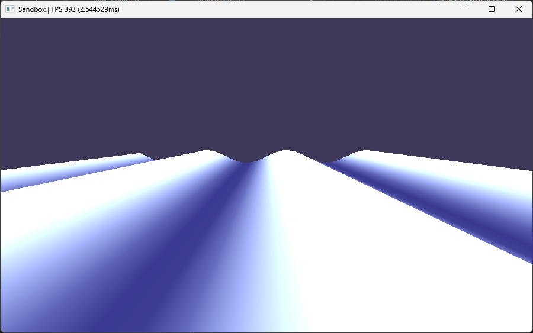
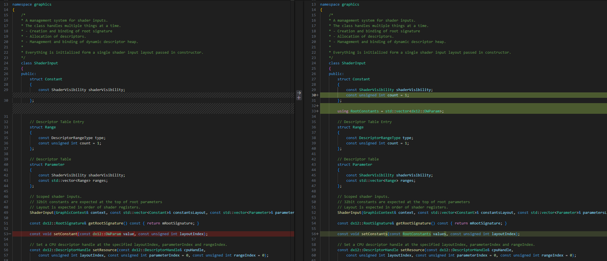

```
[SOFT ASSERT] 2025-06-02 10:20:06 | DescriptorHeapWithAllocator.cpp | graphics::DescriptorHeapWithAllocator::allocatePage:55 | Descriptor Heap out of space. Overwriting from the beginning.
A breakpoint instruction (__debugbreak() statement or a similar call) was executed in Sandbox.exe.

Exception thrown at 0x00007FFB20D59F0A (KernelBase.dll) in Sandbox.exe: 0x0000087D (parameters: 0x0000000000000000, 0x00000052B93BAE00, 0x0000015FD4940FD0).
Unhandled exception at 0x00007FFB20D59F0A (KernelBase.dll) in Sandbox.exe: 0x0000087D (parameters: 0x0000000000000000, 0x00000052B93BAE00, 0x0000015FD4940FD0).
```



<video width="320" height="240" controls>
  <source src="./sine_wave_shiver.mkv" type="video/mkv">
</video>

<video width="320" height="240" controls>
  <source src="./sine_wave.mkv" type="video/mkv">
</video>



<video width="320" height="240" controls>
  <source src="./one_gerstner_wave.mkv" type="video/mkv">
</video>